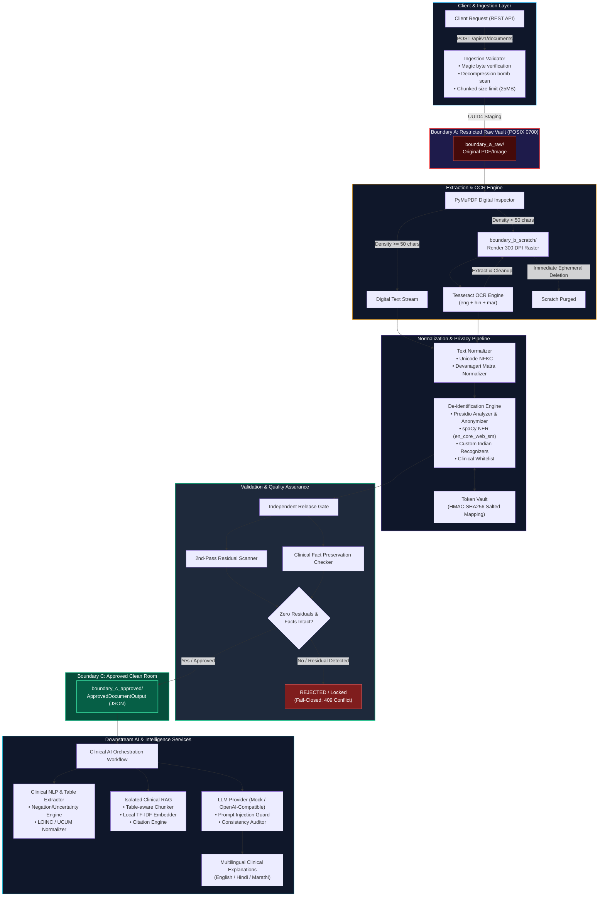

# Clinivara: Privacy-First Clinical Document Intelligence

> **An applied AI engineering prototype designed to process sensitive medical reports, de-identify protected health information using defense-in-depth privacy boundaries, and generate grounded, multilingual clinical explanations in English, Hindi, and Marathi.**

[](https://github.com/AbhijeetArunGore/Clinivara/actions/workflows/ci.yml)
[](https://www.python.org/downloads/)
[](https://fastapi.tiangolo.com)
[](https://docs.pydantic.dev/)
[](tests/)

---

## Table of Contents

- [A. Project Overview](#a-project-overview)
- [B. Problem Statement](#b-problem-statement)
- [C. Key Features](#c-key-features)
- [D. System Architecture](#d-system-architecture)
- [E. How Clinivara Works](#e-how-clinivara-works)
- [F. Technology Deep Dive](#f-technology-deep-dive)
  - [1. Python 3.12](#1-python-312)
  - [2. FastAPI & Uvicorn](#2-fastapi--uvicorn)
  - [3. Pydantic v2 & Pydantic-Settings](#3-pydantic-v2--pydantic-settings)
  - [4. PyMuPDF (fitz)](#4-pymupdf-fitz)
  - [5. Tesseract OCR & Pillow](#5-tesseract-ocr--pillow)
  - [6. Microsoft Presidio (Analyzer & Anonymizer)](#6-microsoft-presidio-analyzer--anonymizer)
  - [7. spaCy NLP Engine](#7-spacy-nlp-engine)
  - [8. Custom Indian Healthcare Identity Recognizers](#8-custom-indian-healthcare-identity-recognizers)
  - [9. Cryptographic Pseudonymization & HMAC-SHA256 Token Vault](#9-cryptographic-pseudonymization--hmac-sha256-token-vault)
  - [10. Independent Second-Pass Safety Release Gate](#10-independent-second-pass-safety-release-gate)
  - [11. Multilingual Clinical NLP & Assertion Detection](#11-multilingual-clinical-nlp--assertion-detection)
  - [12. Laboratory Table Extractor & LOINC/UCUM Normalization](#12-laboratory-table-extractor--loincucum-normalization)
  - [13. Clinical RAG & Multilingual Vector Embeddings](#13-clinical-rag--multilingual-vector-embeddings)
  - [14. AI Safety Guardrails & Evidence Consistency Auditor](#14-ai-safety-guardrails--evidence-consistency-auditor)
  - [15. Docker & Containerized Isolation](#15-docker--containerized-isolation)
- [G. Privacy and Security Architecture](#g-privacy-and-security-architecture)
- [H. Clinical NLP and Medical Document Understanding](#h-clinical-nlp-and-medical-document-understanding)
- [I. Testing and Validation](#i-testing-and-validation)
- [J. Technology Stack](#j-technology-stack)
- [K. Installation and Local Setup](#k-installation-and-local-setup)
- [L. Project Structure](#l-project-structure)
- [M. Limitations and Responsible Use](#m-limitations-and-responsible-use)
- [N. Future Scope](#n-future-scope)
- [O. Contribution and License](#o-contribution-and-license)

---

## A. Project Overview

**Clinivara** is a backend system engineered for healthcare organizations, clinicians, and health-tech applications that need to interpret complex clinical documents without compromising patient confidentiality.

When patients receive diagnostic reports (such as complete blood counts, metabolic profiles, or discharge summaries), the text is dense with specialized terminology, abbreviations, and numerical measurements. Modern Large Language Models (LLMs) can explain these findings in plain language; however, transmitting raw medical reports to external cloud APIs exposes Protected Health Information (PHI) and Personally Identifiable Information (PII) to potential data leakage, violating data governance standards such as the Indian Digital Personal Data Protection (DPDP) Act, HIPAA, and GDPR.

Clinivara establishes an architectural trust boundary around medical data. It ingests clinical PDFs and scanned images, extracts high-fidelity text using a density-driven Optical Character Recognition (OCR) fallback, strips direct and indirect personal identifiers through layered Natural Language Processing (NLP) recognizers, validates the anonymized text through an independent fail-closed safety gate, and only then allows downstream AI components to generate grounded, multilingual explanations in **English, Hindi (हिंदी), and Marathi (मराठी)**.

---

## B. Problem Statement

Healthcare document processing faces three significant challenges:

1. **Cognitive Burden of Clinical Jargon and Unstructured Data**:
   Routine lab reports present dense numerical tables, reference ranges, and Latin clinical shorthand (e.g., `HbA1c 8.4%`, `Metformin 500 mg PO BID`, `denies chest pain`). Patients frequently struggle to interpret whether values are dangerous or normal, leading to anxiety or missed follow-ups.

2. **Language and Regional Accessibility Barriers**:
   In multilingual nations like India, medical reports and consultations are predominantly authored in English. Millions of patients and their primary caregivers comprehend health instructions significantly better in their native regional languages (such as Hindi or Marathi). Direct automated machine translation often corrupts critical units of measure, drug names, or laboratory flags.

3. **The Data Privacy Dilemma in Applied AI**:
   Submitting raw medical records to public cloud-hosted AI APIs exposes sensitive identifiers—including patient names, mobile numbers, Aadhaar numbers, Permanent Account Numbers (PAN), Ayushman Bharat Health Account (ABHA) IDs, and hospital Medical Record Numbers (MRNs). Once transmitted across an untrusted network, patient confidentiality is irreversibly compromised.

### How Clinivara Solves This:
Clinivara enforces a **Zero-Unvalidated-Egress** invariant. Downstream AI components, vector databases, and translation engines never interact with raw clinical files or unredacted text. Every document is de-identified, verified by an independent second-pass scanner, and stored across isolated filesystem boundaries before any clinical explanation or Retrieval-Augmented Generation (RAG) operation occurs.

---

## C. Key Features

- **Format-Agnostic Ingestion**: Validates file magic bytes, limits memory streaming, and prevents pixel-bomb denial-of-service (DoS) attacks on PDF, PNG, and JPEG files.
- **Selective OCR Pipeline**: Employs PyMuPDF for high-speed digital text extraction, automatically falling back to Tesseract OCR (300 DPI) only on pages with insufficient digital text density ($< 50$ characters).
- **Multi-Layered Indian Identity De-identification**: Combines Microsoft Presidio, spaCy NLP, and custom regex pattern recognizers tailored for Indian identifiers (Aadhaar, PAN, ABHA IDs, mobile numbers, hospital MRNs).
- **Clinical Vocabulary Whitelisting**: Protects medical conditions (e.g., *Parkinson's disease*, *Hodgkin's lymphoma*), drug names (*Metformin*, *Atorvastatin*), and metric units from being erroneously redacted as personal names.
- **Independent Fail-Closed Release Gate**: A non-collaborative second-pass validator verifies zero residual personal identifiers and confirms preservation of critical clinical numbers before granting release approval.
- **Clinical NLP & Assertion Detection**: Evaluates whether clinical findings are negated (e.g., *"denies chest pain"* / *"कोणताही पुरावा नाही"*), uncertain, or historical across English, Hindi, and Marathi.
- **Laboratory Table Parser & LOINC Adapter**: Parses multi-column tabular observations into strongly typed Pydantic models with Unified Code for Units of Measure (UCUM) validation and Logical Observation Identifiers Names and Codes (LOINC) concept mapping.
- **Isolated Clinical RAG**: Implements section- and table-aware document chunking, sublinear term-frequency vectorization, and grounded question answering with exact page citations.
- **Deterministic Offline Operation**: Ships with a fully functional `MockLLMProvider` and local TF-IDF vectorizer, allowing complete offline execution and testing without third-party API dependencies or GPU hardware.
- **Tamper-Evident Audit Logging**: Emits append-only JSON Lines records with newline/control-character sanitization to defend against log injection attacks.

---

## D. System Architecture

The following diagram illustrates the data flow, component boundaries, and trust transitions enforced by Clinivara:



---

## E. How Clinivara Works

Clinivara processes documents through a deterministic, auditable multi-stage lifecycle:

```
[Document Upload] ➔ [Ingestion Validation] ➔ [Extraction/OCR] ➔ [Normalization] ➔ [De-identification] ➔ [Release Gate] ➔ [AI Reasoning & RAG]
```

### Stage 1: Secure Ingestion and Header Verification
- **Operation**: The client uploads a clinical file (`.pdf`, `.png`, or `.jpeg`) along with their API key via `POST /api/v1/documents`.
- **Validation**: Clinivara bypasses client-supplied `Content-Type` headers and inspects initial magic bytes (`%PDF-`, `\x89PNG`, `\xff\xd8\xff`). Pillow checks image dimensions to prevent decompression bombs ($< 8000 \times 8000$ pixels, $< 50$ megapixels). Files exceeding 25 MB are rejected during chunked streaming.
- **Output**: The file is stored in `boundary_a_raw/` using a server-generated `UUID4` identifier. The client's original filename is stripped to eliminate path traversal vulnerabilities.

### Stage 2: Dual-Track Text Extraction
- **Operation**: The system inspects the document structure using PyMuPDF (`fitz`).
- **Logic**: For each page, the character count of digital text is evaluated. If the page contains $\ge 50$ characters, the text stream is extracted directly. If a page has $< 50$ characters (e.g., scanned lab slip or physical fax), that individual page is rendered to a temporary 300 DPI bitmap in `boundary_b_scratch/` and processed by Tesseract OCR configured for English, Hindi, and Marathi.
- **Cleanup**: Intermediate bitmap renders in Boundary B are immediately unlinked upon completion.

### Stage 3: Normalization and Canonical Cleansing
- **Operation**: Text extracted from PyMuPDF or Tesseract is normalized using Unicode NFKC.
- **Indic Normalization**: A dedicated Devanagari normalizer corrects OCR matra separation artifacts (e.g., converting disconnected consonant-vowel pairs `क ा` to `का`), replaces Devanagari danda punctuation (`।`, `॥`) with standard sentence terminators, and converts Devanagari numerals (`०१२३४५६७८९`) into standard Arabic numerals (`0-9`) so downstream lab parsers can evaluate numerical values.

### Stage 4: Multi-Layered Sensitive Information Detection
- **Operation**: The normalized text is analyzed for personal identifiers using Microsoft Presidio, spaCy, and custom regex recognizers.
- **Transformation**: Identifiers are replaced according to configured policy (redaction masks such as `[PATIENT_NAME]`, `[GOV_ID]`, `[PHONE_NUMBER]`, or cryptographically salted tokens like `[PATIENT_ID_4A8F9B2C10DE]`).
- **Safeguard**: Words matching the clinical whitelist (e.g., *diabetes*, *hypertension*, *hemoglobin*, *metformin*, *mg/dL*) are protected from entity replacement.

### Stage 5: Independent Second-Pass Validation Gate
- **Operation**: The scrubbed text is evaluated by `ReleaseGate`, which invokes an independent `ResidualIdentifierScanner`.
- **Enforcement**: If the secondary scanner finds any residual unredacted pattern (such as an unbracketed 10-digit number, an Aadhaar pattern, an unredacted email, or a leaked internal file path), the document is marked `REJECTED`. The approved clean room (`boundary_c_approved/`) rejects the record, and downstream AI routes return an HTTP 409 Conflict.

### Stage 6: Structured Clinical Analysis and Multilingual RAG
- **Operation**: Once a document achieves `APPROVED` status, downstream modules can analyze the clean text.
- **Execution**: The document classifier categorizes the report (e.g., Complete Blood Count, Lipid Profile, Renal Function Test). The table parser extracts tabular findings into strongly typed `ClinicalObservation` records, mapping test names to canonical LOINC concepts and evaluating numerical flags (`HIGH`, `LOW`, `NORMAL`).
- **Multilingual Delivery**: Grounded patient-facing explanations and interactive questions are answered in English, Hindi, or Marathi, complete with exact source line citations.

---

## F. Technology Deep Dive

Each major technology utilized within Clinivara is detailed below using a two-layer explanation pattern.

---

### 1. Python 3.12

**In Simple Terms:**
Python is the foundational programming language that acts as the primary construction material for the entire application, directing how data moves from one step to the next.

**Technical Explanation:**
Clinivara is built natively on Python 3.12, leveraging its performance improvements (such as PEP 659 adaptive specializing interpreter enhancements) and modern typing features. It utilizes union operators (`X | Y`), parameterized generics (`type[T]`), and frozen data models to maintain strict static type contracts.

- **Role in Clinivara**: Executes the core backend runtime across ingestion, extraction, redaction, and AI orchestration.
- **Engineering Benefit**: Combines deep scientific computing ecosystems (NumPy, SciPy, scikit-learn) with modern asynchronous web processing.

---

### 2. FastAPI & Uvicorn

**In Simple Terms:**
FastAPI and Uvicorn function like an organized hospital administrative desk. When an outside application sends a file or asks a question, this layer receives the request, verifies authentication, directs the job to the correct department, and returns structured responses.

**Technical Explanation:**
FastAPI is a high-performance web framework based on Starlette and Pydantic, executing asynchronously under Uvicorn, an ASGI server built on `uvloop` and `httptools`. Clinivara uses dependency injection (`fastapi.Depends`) for API key authentication, tenant context extraction, and centralized HTTP exception handling.

- **Role in Clinivara**: Serves all REST endpoints across document management (`/api/v1/documents/*`) and clinical AI processing (`/api/v1/ai/*`), generating interactive OpenAPI specifications at `/docs`.
- **Engineering Benefit**: Provides asynchronous, non-blocking I/O capable of handling concurrent file uploads without blocking worker threads.

---

### 3. Pydantic v2 & Pydantic-Settings

**In Simple Terms:**
Pydantic acts like a strict compliance inspector holding an official checklist. If any incoming file, configuration setting, or AI response is missing required data or contains invalid types, it rejects the operation immediately.

**Technical Explanation:**
Pydantic v2 utilizes a Rust-based validation core (`pydantic-core`) to serialize and validate data models with minimal overhead. Clinivara defines all system settings via `pydantic-settings.BaseSettings`, reading from environment variables with strong typing, bounds checks, and field validators.

- **Role in Clinivara**: Enforces data schemas for document intake, clinical observations, RAG citations, and environment settings.
- **Engineering Benefit**: Validates configurations at application boot, refusing to initialize if insecure secrets or misconfigured bounds are detected.

---

### 4. PyMuPDF (`fitz`)

**In Simple Terms:**
PyMuPDF functions like a high-speed digital document reader. When given an electronic PDF, it reads the embedded computer text directly off the page in milliseconds.

**Technical Explanation:**
PyMuPDF provides Python bindings for MuPDF, a lightweight C-based rendering and PDF-parsing library. Rather than treating every document as a scanned image, Clinivara inspects the digital text layer of each PDF page, measuring character counts and layout coordinates.

- **Role in Clinivara**: Primary extraction tool for digital PDFs; calculates page-level text density and renders selective pages to 300 DPI rasters when OCR fallback is required.
- **Engineering Benefit**: Extracting embedded text directly is up to 50 times faster and significantly more accurate than running OCR across every page of an electronically generated document.

---

### 5. Tesseract OCR & Pillow

**In Simple Terms:**
When a document is a scanned image or photo rather than a digital file, Tesseract and Pillow examine the pixels like an investigator using a magnifying glass to read the printed words.

**Technical Explanation:**
Pillow (`PIL`) provides image validation, dimension bounds verification, and color-space conversion. Tesseract OCR (`pytesseract`) is an optical character recognition engine. Clinivara executes Tesseract at 300 DPI across English (`eng`), Hindi (`hin`), and Marathi (`mar`) language models, measuring word-level confidence scores via `image_to_data`.

- **Role in Clinivara**: Provides selective fallback text extraction for scanned lab reports and physical clinical documentation.
- **Engineering Benefit**: Captures text from legacy or photographed medical records while measuring confidence metrics to warn clinicians of degraded input quality.

---

### 6. Microsoft Presidio (Analyzer & Anonymizer)

**In Simple Terms:**
Presidio is an automated redaction system that scans text for sensitive personal details and covers them with standardized placeholders, such as replacing a patient's name with `[PATIENT_NAME]`.

**Technical Explanation:**
Microsoft Presidio is an extensible framework for identifying and de-identifying PII. The `AnalyzerEngine` coordinates pattern recognizers, rule-based contexts, and NLP models to produce entity detections with associated confidence scores. The `AnonymizerEngine` replaces detected spans with configured operators (masks, redact, hash).

- **Role in Clinivara**: Orchestrates the primary de-identification pass, transforming detected patient identifiers into standardized replacement tokens.
- **Engineering Benefit**: Eliminates hardcoded redaction logic through an extensible, enterprise-tested entity detection pipeline.

---

### 7. spaCy NLP Engine

**In Simple Terms:**
spaCy is a language analysis engine that reads sentences to understand grammar and context. It helps distinguish whether a word like "May" refers to a calendar month or a doctor's surname.

**Technical Explanation:**
spaCy provides statistical natural language processing capabilities, including tokenization, Part-Of-Speech (POS) tagging, and Named Entity Recognition (NER). Clinivara utilizes the `en_core_web_sm` model integrated directly as the NLP backend for Presidio's analyzer.

- **Role in Clinivara**: Detects contextual named entities (`PERSON`, `ORG`, `GPE`, `DATE`) within unstructured doctor clinical notes.
- **Engineering Benefit**: Provides robust, context-sensitive entity recognition that complements deterministic regular expressions.

---

### 8. Custom Indian Healthcare Identity Recognizers

**In Simple Terms:**
Standard international privacy software does not recognize Indian identity cards. Clinivara includes custom scanning patterns specifically designed to detect Indian identification numbers like Aadhaar, PAN, and ABHA IDs.

**Technical Explanation:**
Clinivara implements custom Presidio pattern recognizers in `clinivara/deidentification/recognizers/patterns.py`. These use regular expressions combined with surrounding context word heuristics (e.g., *uidai*, *income tax*, *ayushman*, *ndhm*, *uhid*) to detect:
- **Aadhaar Numbers**: `r"\b[2-9]\d{3}\s?\d{4}\s?\d{4}\b"`
- **PAN Cards**: `r"\b[A-Z]{5}[0-9]{4}[A-Z]\b"`
- **ABHA / Health IDs**: `r"\b\d{2}-\d{4}-\d{4}-\d{4}\b"`
- **Indian Mobile Numbers**: `r"(?:\+91[\-\s]?)?[6-9]\d{4}[\-\s]?\d{5}\b"`
- **Hospital MRNs / UHIDs**: Prefix-structured medical chart numbers.

- **Role in Clinivara**: Detects regional healthcare identifiers native to Indian healthcare systems that generic models fail to recognize.
- **Engineering Benefit**: Closes critical compliance gaps for Indian healthcare data governance under the DPDP Act.

---

### 9. Cryptographic Pseudonymization & HMAC-SHA256 Token Vault

**In Simple Terms:**
If a patient visits the clinic three times, doctors need to know all three reports belong to the same person without seeing their real name. Clinivara turns the patient's ID into a secure code using a secret cryptographic key, keeping the translation list locked in a separate safe.

**Technical Explanation:**
Clinivara provides deterministic pseudonymization via Hash-based Message Authentication Codes using SHA-256 (`HMAC-SHA256`). When longitudinal linking is enabled, an identifier is hashed with a high-entropy salt:
$$\text{Token} = \text{HMAC-SHA256}(\text{Salt}, \text{EntityType} \parallel \text{NormalizedValue})[:12]$$
The mapping is written exclusively to the isolated `token_vault/` partition and is completely excluded from downstream AI contexts.

- **Role in Clinivara**: Enables longitudinal analytics and record association without exposing plain-text identities.
- **Engineering Benefit**: Resists rainbow table and dictionary attacks; allows controlled, auditable re-identification strictly when authorized by organizational policy.

---

### 10. Independent Second-Pass Safety Release Gate

**In Simple Terms:**
Before an airplane takes off, baggage goes through a second security scanner independent of the first officer. Clinivara uses an independent safety gate to inspect scrubbed documents: if even one personal identifier remains, the document is blocked from reaching the AI.

**Technical Explanation:**
Probabilistic NLP models (Presidio, spaCy) achieve high recall but cannot mathematically guarantee zero false negatives. Clinivara implements an independent, non-collaborative `ResidualIdentifierScanner` that evaluates scrubbed text using strict heuristic patterns and verifies that clinical laboratory metrics were not erroneously removed. If residual count $> 0$, the gate assigns a status of `REJECTED`.

- **Role in Clinivara**: Enforces a fail-closed boundary between de-identification and downstream AI consumers.
- **Engineering Benefit**: Prevents unredacted PHI/PII from ever entering downstream LLM prompts or vector embeddings.

---

### 11. Multilingual Clinical NLP & Assertion Detection

**In Simple Terms:**
If a report states *"Patient denies chest pain"*, a simple keyword search might see "chest pain" and assume the patient is having an emergency. This engine understands that "denies" means the symptom is absent, working in English, Hindi, and Marathi.

**Technical Explanation:**
Located in `clinivara/nlp/negation.py`, this module analyzes clinical assertions for:
- **Negation**: Triggers such as *"denies"*, *"negative for"*, *"absence of"*, *"नहीं है"*, *"लक्षणे नाहीत"*.
- **Uncertainty**: Markers such as *"suspected"*, *"borderline"*, *"rule out"*, *"संभावित"*, *"संशयित"*.
- **Temporality**: Distinguishes historical conditions (*"history of"*, *"मागील"*) and familial conditions (*"family history"*).

- **Role in Clinivara**: Accurately establishes whether documented clinical conditions are present, absent, or suspected before generating explanations.
- **Engineering Benefit**: Prevents severe clinical misinformation that arises when LLMs misinterpret negated symptoms.

---

### 12. Laboratory Table Extractor & LOINC/UCUM Normalization

**In Simple Terms:**
Lab reports from different hospitals use different names for the same test (e.g., "FBS" vs. "Fasting Blood Sugar"). This module organizes tables into a standard format and maps test names to standard universal medical codes.

**Technical Explanation:**
The `LabTableExtractor` uses regular expressions and tabular line parsers to extract parameters, numerical values, units, and reference intervals. Test names are normalized against a baseline Logical Observation Identifiers Names and Codes (LOINC) dictionary (e.g., mapping *HbA1c* to LOINC `4548-4`), and units are validated against Unified Code for Units of Measure (UCUM) standards.

- **Role in Clinivara**: Converts raw, unstructured text into strongly typed `ClinicalObservation` records with automatic evaluation of flags (`HIGH`, `LOW`, `NORMAL`).
- **Engineering Benefit**: Provides structured, validated numerical inputs for downstream AI reasoning rather than relying on LLMs to parse tabular data from raw text.

---

### 13. Clinical RAG & Multilingual Vector Embeddings

**In Simple Terms:**
Rather than allowing an AI to guess answers from memory, Clinical RAG works like an open-book exam: the system looks up the exact approved paragraph in the medical report and includes page citations with every answer.

**Technical Explanation:**
Clinivara implements an isolated Retrieval-Augmented Generation (RAG) pipeline:
- **Chunking**: `ClinicalDocumentChunker` splits approved text into semantic chunks while keeping tabular rows and reference intervals intact.
- **Embeddings**: `LocalMultilingualEmbedder` generates sublinear TF-IDF vectors using character (3–5) and word n-grams across Devanagari and Latin scripts via `scikit-learn`.
- **Isolation**: Vectors are indexed in `IsolatedDocumentIndex`, strictly partitioned by `tenant_id` and `document_id`.
- **Citations**: Queries generate explicit citations mapping statements to page numbers and exact evidence snippets.

- **Role in Clinivara**: Powers grounded clinical question answering (`POST /api/v1/ai/documents/{id}/questions`).
- **Engineering Benefit**: Eliminates cross-tenant data leakage, guarantees evidence grounding, and runs completely offline without requiring GPU resources or remote vector database services.

---

### 14. AI Safety Guardrails & Evidence Consistency Auditor

**In Simple Terms:**
This layer acts like a lie detector and security guard. It ensures malicious users cannot trick the AI with prompt injection attacks and verifies that numbers generated in explanations match the real lab results.

**Technical Explanation:**
Located in `clinivara/ai/guardrails/`:
- **`PromptInjectionGuard`**: Evaluates inputs against adversarial jailbreak signatures, system prompt override attempts, and instruction injection across English, Hindi, and Marathi.
- **`ClinicalConsistencyAuditor`**: Audits LLM-generated explanations against source observations, verifying that numerical values (e.g., `8.4%`), units, and negation states were not altered during generation.

- **Role in Clinivara**: Protects the LLM orchestration pipeline from prompt injection and prevents factual hallucinations in clinical explanations.
- **Engineering Benefit**: Provides automated, programmatic verification of LLM output safety prior to patient delivery.

---

### 15. Docker & Containerized Isolation

**In Simple Terms:**
Docker packages the entire system, its tools, and required language models into a self-contained software container that runs consistently on any server without installation conflicts.

**Technical Explanation:**
Clinivara provides a multi-stage `Dockerfile` based on `python:3.12-slim-bookworm` containing pre-installed Tesseract packages, language data (`eng`, `hin`, `mar`), and dependencies. It executes under an unprivileged user (`clinivara:1001`) with strict filesystem permission boundaries (`chmod 700 /app/data/storage`). `docker-compose.yml` mounts storage volumes for raw and approved data while keeping temporary scratch storage purely ephemeral.

- **Role in Clinivara**: Standardizes packaging, continuous integration, and secure container deployment.
- **Engineering Benefit**: Eliminates environment drift, restricts OS-level attack surfaces, and enforces memory and CPU limits.

---

## G. Privacy and Security Architecture

Clinivara enforces a strict **Three-Vault Processing Architecture** that physically isolates data based on classification and lifecycle:

```
+-----------------------------------------------------------------------------------------+
|                                  STORAGE VAULT SYSTEM                                   |
|                                                                                         |
|  +---------------------------+   +---------------------------+   +--------------------+ |
|  |  Vault A: Raw Storage     |   |  Vault B: Scratchpad      |   |  Vault C: Clean    | |
|  |  (boundary_a_raw/)        |   |  (boundary_b_scratch/)    |   |  (boundary_c/)     | |
|  |                           |   |                           |   |                    | |
|  | • Original uploaded files |-->| • Temporary 300 DPI image |-->| • Validated data   | |
|  | • Contains direct PII/PHI |   | • Selective OCR engine    |   | • 0 residual PII   | |
|  | • Strictly restricted     |   | • Immediately unlinked    |   | • Only partition   | |
|  |   (POSIX 0700 file mode)  |   |   after OCR processing    |   |   downstream AI    | |
|  | • Never read by AI        |   | • Strictly ephemeral      |   |   can access       | |
|  +---------------------------+   +---------------------------+   +--------------------+ |
+-----------------------------------------------------------------------------------------+
```

### Vault Partitioning Details

| Vault | Directory Path | Data Contained | Access Rules | Lifecycle |
|---|---|---|---|---|
| **Vault A: Restricted Raw Document Storage** | `data/storage/boundary_a_raw/` | Original uploaded PDFs and raster images with real patient identities intact. | Ingestion and Extraction services only. Stored under randomized `UUID4` filenames. | Retained according to organizational medical record retention policies. |
| **Vault B: Temporary Processing Environment** | `data/storage/boundary_b_scratch/` | Rendered 300 DPI page bitmaps and temporary OCR files. | Accessible exclusively to local OCR worker routines. | **Strictly ephemeral**: Auto-deleted immediately upon page extraction completion or on job failure. Not mounted in Docker volumes. |
| **Vault C: Validated De-identified Clean Room** | `data/storage/boundary_c_approved/` | Validated, policy-approved de-identified JSON documents (`ApprovedDocumentOutput`). | Accessible to authorized clinical consumers and downstream AI pipelines. | Persistent approved records. |
| **Token Vault** | `data/storage/token_vault/` | `HMAC-SHA256` salted token mappings connecting pseudonyms to original identifiers. | Isolated completely from Vault C and API endpoints. Stored under separate tenant paths. | Retained only when longitudinal patient tracking is explicitly enabled. |

### Defense-in-Depth Security Controls

1. **Path Traversal Defense**: All file interactions pass through `StorageManager._ensure_within_vault()`, which verifies that resolved filesystem paths remain strictly within designated vault roots. User-provided filenames are stripped of path delimiters and null bytes via `sanitize_filename()`.
2. **Constant-Time Authentication**: Client API keys are verified using `secrets.compare_digest` in `verify_api_key()`, preventing side-channel timing attacks.
3. **Log Injection Sanitization**: The structured audit logger sanitizes all recorded values through `re.sub(r"[\r\n\x00-\x1f\x7f-\x9f]", " ", text)`, preventing log forging. Raw clinical text and unredacted names are never emitted to logs.
4. **Defensive HTTP Headers**: Responses automatically enforce security headers including `X-Content-Type-Options: nosniff`, `X-Frame-Options: DENY`, `Strict-Transport-Security`, and restrictive Content Security Policies.
5. **Fail-Closed Release Invariant**: If the second-pass privacy scanner detects any residual identifier or if clinical numbers are missing from the de-identified output, the document status is set to `REJECTED`, and retrieval via downstream AI endpoints is blocked.

---

## H. Clinical NLP and Medical Document Understanding

Clinivara treats clinical text as structured medical evidence rather than arbitrary strings.

### 1. Assertion and Negation Handling
In clinical documentation, understanding whether a symptom is confirmed or denied is vital. The `ClinicalNegationDetector` uses syntactic patterns across three languages:

*Example Scenario:*
```
Original text: "Patient denies shortness of breath. No evidence of diabetic ketoacidosis."
```
- **Standard Keyword Search**: Flags "shortness of breath" and "diabetic ketoacidosis" as active conditions.
- **Clinivara Assertion Detector**: Identifies the triggers `"denies"` and `"no evidence of"`, assigning `is_negated = True`. Downstream AI explanations accurately communicate that these conditions are **absent**.

*Multilingual Assertion Triggers:*
- **English**: `denies`, `no evidence of`, `rules out`, `absence of`, `unremarkable`
- **Hindi (हिंदी)**: `कोई प्रमाण नहीं`, `नकारात्मक`, `नहीं पाया गया`, `शिकायत नहीं`, `नहीं है`
- **Marathi (मराठी)**: `कोणताही पुरावा नाही`, `नकारात्मक`, `आढळले नाही`, `लक्षणे नाहीत`, `नाही`

### 2. Structured Laboratory Table Extraction
Laboratory reports present measurements across rows with reference intervals. Clinivara transforms unstructured table text into structured `ClinicalObservation` records:

*Unstructured Input:*
```
Test Name                 Result      Unit       Reference Interval    Flag
Fasting Blood Sugar       162         mg/dL      70 - 99               HIGH
Serum Creatinine          1.1         mg/dL      0.7 - 1.3             NORMAL
HbA1c                     8.4         %          4.0 - 5.6             HIGH
```

*Structured Pydantic Model Output:*
```json
{
  "test_name": "Fasting Blood Sugar",
  "canonical_name": "Fasting Glucose [Mass/volume] in Blood",
  "loinc_code": "1558-6",
  "value": 162.0,
  "unit": "mg/dL",
  "reference_range": { "low": 70.0, "high": 99.0, "raw_text": "70 - 99" },
  "flag": "HIGH",
  "is_abnormal": true,
  "confidence": 0.95
}
```

### 3. Multilingual Clinical Terminology
Clinivara normalizes Devanagari script and maintains clinical dictionaries to translate findings into natural, patient-accessible explanations without losing numerical precision:

| Clinical Finding | English Explanation | Hindi (हिंदी) | Marathi (मराठी) |
|---|---|---|---|
| `HbA1c: 8.4% (HIGH)` | Average blood sugar over the last 3 months is elevated. | पिछले 3 महीनों का औसत रक्त शर्करा स्तर सामान्य से अधिक है। | मागील ३ महिन्यांची सरासरी रक्तातील साखर सामान्य पातळीपेक्षा जास्त आहे. |
| `Creatinine: 1.1 mg/dL` | Kidney function test value is within normal limits. | किडनी कार्य परीक्षण सामान्य सीमा के भीतर है। | मूत्रपिंड कार्य चाचणी सामान्य मर्यादेत आहे. |
| `Metformin 500 mg PO BID` | Take 1 tablet by mouth twice daily. | दिन में दो बार 1 गोली मुंह से लें। | दिवसातून दोनदा १ गोळी तोंडाने घ्या. |

---

## I. Testing and Validation

Clinivara maintains an automated test suite executed via `pytest`.

```
========================= 73 passed, 1 warning in 2.63s =========================
```

### Test Suite Breakdown (73 Automated Tests)

| Test Module | Test Count | Focus Area |
|---|---|---|
| `test_security_audit_hardening.py` | 14 | Production placeholder rejection, minimum secret/salt/key lengths, path traversal defense, streaming upload bounds. |
| `test_multilingual_ai.py` | 10 | Language detection, Devanagari Unicode normalization, matra repairs, Indic digit conversion, clinical translation. |
| `test_ai_api.py` | 9 | REST endpoints (`/health`, `/capabilities`, `/languages`, `/explain`, `/questions`, `/translate`, authentication). |
| `test_clinical_extraction.py` | 7 | Document classification, tabular key-value parsing, LOINC mapping, UCUM unit validation, negation detection. |
| `test_ai_orchestration.py` | 6 | Prompt registry integrity, mock LLM structured output, prompt injection guard, numerical consistency auditor. |
| `test_security_adversarial.py` | 5 | Path traversal, log injection defense, unauthenticated request rejection, tenant isolation, security headers. |
| `test_validator.py` | 5 | Magic byte detection, empty file rejection, MIME spoofing defense, decompression bomb prevention. |
| `test_release_gate.py` | 4 | Independent residual detection, fail-closed approval, clinical fact preservation verification. |
| `test_clinical_rag.py` | 4 | Table-aware chunking, multilingual vector dimension consistency, cross-tenant isolation, citation mapping. |
| `test_normalization.py` | 3 | Unicode NFKC normalization, clinical symbol/unit preservation, clinical section segmenting. |
| `test_e2e_pipeline.py` | 2 | End-to-end digital PDF pipeline and scanned raster image OCR pipeline. |
| `test_extraction.py` | 2 | PyMuPDF digital text extraction and Tesseract OCR raster extraction. |
| `test_deidentification.py` | 2 | Sensitive entity redaction and clinical whitelist term protection. |

### Continuous Integration (CI) Workflow
Clinivara executes an automated GitHub Actions pipeline (`.github/workflows/ci.yml`) on every push and pull request to `main`:
1. **Linting & Code Quality**: `ruff check .` and `ruff format --check .`
2. **Static Secret Scanning**: `gitleaks-action` scans the complete git commit history to prevent credential or secret leaks.
3. **Automated Test Matrix**: Installs Ubuntu dependencies (`tesseract-ocr`, `tesseract-ocr-eng`, `tesseract-ocr-hin`, `tesseract-ocr-mar`, `libmupdf-dev`), downloads `en_core_web_sm`, and runs `pytest -v --durations=10`.

---

## J. Technology Stack

| Category | Technology / Library | Purpose in Clinivara |
|---|---|---|
| **Language & Runtime** | Python 3.12 | Core application execution and typed asynchronous programming. |
| **API Framework** | FastAPI (v0.115+) | High-performance asynchronous REST API routing and OpenAPI documentation. |
| **ASGI Server** | Uvicorn (v0.30+) | Asynchronous server implementation with `uvloop` support. |
| **Data Validation** | Pydantic v2 (v2.9+) | Rust-powered data contract validation and settings management. |
| **Document Parsing** | PyMuPDF / fitz (v1.24+) | Digital PDF text extraction and selective high-resolution page rendering. |
| **OCR & Image Processing** | Tesseract OCR & Pillow (v10.4+) | Raster image inspection, decompression safety, and multilingual OCR fallback. |
| **De-identification** | Microsoft Presidio (v2.2+) | Analyzer and Anonymizer engines for sensitive entity detection and redaction. |
| **Natural Language Processing** | spaCy (v3.7+) | Statistical tokenization, POS tagging, and NER (`en_core_web_sm`). |
| **Cryptography** | Python Standard `hmac` & `hashlib` | Salted `HMAC-SHA256` token generation for deterministic pseudonymization. |
| **Vector Embeddings & RAG** | scikit-learn (v1.5+) & NumPy | Sublinear TF-IDF n-gram vectorization and cosine similarity retrieval. |
| **Testing & Quality** | Pytest, Ruff, Mypy | 73 unit/integration/adversarial tests, linting, and static type checking. |
| **Containerization** | Docker & Docker Compose | Non-root container builds and isolated multi-vault environment deployment. |

---

## K. Installation and Local Setup

### 1. Prerequisites
- **Python**: Version 3.12 or newer.
- **Tesseract OCR**: Installed on the system path with English (`eng`), Hindi (`hin`), and Marathi (`mar`) language packs.
  - **Ubuntu/Debian**:
    ```bash
    sudo apt-get update && sudo apt-get install -y tesseract-ocr tesseract-ocr-eng tesseract-ocr-hin tesseract-ocr-mar libmupdf-dev
    ```
  - **Windows**: Install via [UB-Mannheim Tesseract installer](https://github.com/UB-Mannheim/tesseract/wiki), select Hindi and Marathi script packs during installation, and add the installation folder (e.g., `C:\Program Files\Tesseract-OCR`) to your system `PATH`.
  - **macOS**:
    ```bash
    brew install tesseract tesseract-lang mupdf
    ```

### 2. Clone Repository and Create Virtual Environment

**Windows (PowerShell):**
```powershell
git clone https://github.com/AbhijeetArunGore/Clinivara.git
cd Clinivara

python -m venv .venv
.\.venv\Scripts\Activate.ps1
python -m pip install --upgrade pip
pip install -e ".[dev]"
python -m spacy download en_core_web_sm
```

**Linux / macOS (Bash):**
```bash
git clone https://github.com/AbhijeetArunGore/Clinivara.git
cd Clinivara

python3 -m venv .venv
source .venv/bin/activate
python -m pip install --upgrade pip
pip install -e ".[dev]"
python -m spacy download en_core_web_sm
```

### 3. Environment Configuration
Copy the configuration template to initialize your local `.env` file:
```bash
cp .env.example .env
```
*(On Windows PowerShell, use `Copy-Item .env.example .env`).*

> **Security Notice**: For local testing, default parameters in `.env.example` allow deterministic execution with the offline `mock` provider. For production deployments, high-entropy secrets must be configured via environment variables. Never commit `.env` containing sensitive credentials to version control.

### 4. Run Automated Test Suite
Execute the test suite to verify extraction, de-identification, and security gates:
```bash
python run.py --test
```
*(Or invoke directly via `pytest -v`).*

### 5. Start the Application
Launch the live FastAPI server using the unified runner:
```bash
python run.py
```
- **API Documentation (Swagger UI)**: `http://127.0.0.1:8000/docs`
- **System Health Endpoint**: `http://127.0.0.1:8000/api/v1/health`
- **AI Capabilities Endpoint**: `http://127.0.0.1:8000/api/v1/ai/capabilities`
- **Supported Languages**: `http://127.0.0.1:8000/api/v1/ai/languages`

### 6. Run via Docker Compose
To run Clinivara inside an isolated container with bounded resources:
```bash
docker compose up --build
```

---

## L. Project Structure

```
Clinivara/
├── .github/
│   └── workflows/
│       └── ci.yml                 # GitHub Actions CI matrix (Lint, Gitleaks, Pytest)
├── clinivara/                     # Core Python application package
│   ├── ai/                        # AI orchestration, guardrails, prompts, providers
│   │   ├── guardrails/            # Prompt injection defense & numerical consistency auditor
│   │   ├── orchestration/         # State machine managing clinical analysis workflows
│   │   ├── prompts/               # Versioned prompt registry (Prompts A through G)
│   │   └── providers/             # LLM provider abstraction (MockLLMProvider, OpenAI)
│   ├── api/                       # FastAPI route controllers and dependencies
│   │   ├── ai.py                  # Clinical AI endpoints (/explain, /questions, /extract)
│   │   ├── documents.py           # Document endpoints (POST /, GET /{id}/status, GET /{id}/result, DELETE /{id})
│   │   ├── health.py              # System health check route
│   │   └── router.py              # Master v1 API router
│   ├── audit/                     # Append-only structured JSONL audit logger
│   ├── clinical/                  # Clinical document classifier, LOINC adapter, table parser
│   ├── core/                      # Configuration (BaseSettings), security primitives, errors
│   ├── deidentification/          # Presidio engine, clinical whitelist, Token Vault
│   │   └── recognizers/           # Custom Indian recognizers (Aadhaar, PAN, ABHA, MRN)
│   ├── extraction/                # PyMuPDF digital inspector & selective Tesseract OCR
│   ├── ingestion/                 # Magic byte validation, decompression bomb protection
│   ├── multilingual/              # Language detection, Devanagari Unicode normalizer
│   ├── nlp/                       # Clinical negation, uncertainty, and section detectors
│   ├── normalization/             # Unicode NFKC cleaning, medical unit preservation
│   ├── rag/                       # Table-aware chunker, local TF-IDF vectorizer, citations
│   ├── schemas/                   # Strongly typed Pydantic models (contracts)
│   ├── storage/                   # Three-Vault storage manager (Vaults A, B, C, Token Vault)
│   ├── validation/                # Independent second-pass residual scanner & release gate
│   └── main.py                    # Application factory, security middleware, CORS
├── data/                          # Test fixtures, runtime storage vaults, and audit logs (generated locally; excluded from Git)
├── docs/                          # In-depth architectural and security documentation
├── evaluation/                    # Repeatable evaluation benchmarks for privacy and utility
├── tests/                         # Automated test suite (73 passing tests)
├── .dockerignore                  # Docker build exclusions
├── .env.example                   # Environment configuration template
├── .gitignore                     # Git tracking exclusions
├── CHANGELOG.md                   # Engineering version history
├── docker-compose.yml             # Containerized deployment manifest with resource limits
├── Dockerfile                     # Multi-stage container recipe running as non-root user
├── pyproject.toml                 # Build configuration, tool settings, and dependencies
├── README.md                      # Primary project documentation
└── run.py                         # Single-command unified execution runner
```

---

## M. Limitations and Responsible Use

- **Applied Engineering Prototype**: Clinivara is an engineering research and development prototype built to demonstrate privacy-preserving clinical document architectures. It is not currently certified as a medical device.
- **Not a Medical Substitute**: Explanations generated by downstream AI models are intended for patient empowerment and clinical workflow acceleration. They do not constitute formal medical diagnosis, clinical advice, or treatment plans.
- **Probabilistic Entity Detection**: While multi-layered recognizers and independent second-pass verification significantly reduce leakage risk, automated NLP de-identification cannot mathematically guarantee 100% anonymization across every handwritten style or non-standard format.
- **Regulatory Governance**: Achieving formal compliance with HIPAA, GDPR, or the Indian DPDP Act requires administrative safeguards, Business Associate Agreements (BAAs), staff training, and secure physical infrastructure in addition to technical software controls.
- **OCR Dependencies**: Extraction fidelity for scanned documents is dependent upon image resolution, lighting, and installed Tesseract language training datasets.

---

## N. Future Scope

The following capabilities represent planned technical enhancements:

- **DICOM & Medical Imaging Metadata Ingestion**: Expanding ingestion pipelines to parse DICOM file headers and redact embedded patient metadata tags (PS 3.15 de-identification profile).
- **Dense Local Multilingual Embeddings**: Integrating quantized ONNX-runtime multilingual embedding models (e.g., `paraphrase-multilingual-MiniLM-L12-v2`) for enhanced semantic search in offline environments.
- **FHIR Resource Serialization**: Serializing extracted clinical observations directly into standard HL7 FHIR (Fast Healthcare Interoperability Resources) JSON bundles (`Observation`, `DiagnosticReport`, `Patient`).
- **Distributed Asynchronous Task Queues**: Migrating background OCR and RAG indexing from in-process tasks to distributed worker pools (e.g., Celery/Redis) for horizontal scalability.
- **Active Learning Feedback Loop**: Providing clinician-in-the-loop audit interfaces to flag borderline de-identification spans for continuous recognizer refinement.

---

## O. Contribution and License

### Contributing
Contributions to Clinivara are welcome. Please ensure that all contributions conform to the following standards:
1. All pull requests must pass existing automated tests: `python run.py --test`
2. New features must include corresponding unit tests in `tests/` and maintain static type hints (`mypy`).
3. Code must adhere to Ruff formatting and linting rules: `ruff check .` and `ruff format --check .`
4. Contributions must strictly respect trust boundaries; code that transmits unvalidated clinical text to external endpoints will be rejected.

### License Status
Please refer to the repository settings and source headers for licensing terms. All rights are reserved by the original project author unless explicitly stated otherwise in an official repository license file.

---

## Detailed Technical Documentation Links

For deeper architectural, security, and API specifications, consult the dedicated documentation in [`docs/`](docs/):

- 📐 **[System Architecture](docs/architecture.md)**: Data trust boundaries, component decoupling, and failure models.
- 🔒 **[Security & Threat Model](docs/security.md)**: Defense-in-depth principles, cryptographic boundaries, and STRIDE analysis.
- 🔍 **[Security Audit Report](docs/security-audit.md)**: Documented vulnerability findings, remediation verifications, and CVE/CWE tracking.
- 🛠️ **[Security Remediation Log](docs/security-remediation.md)**: Step-by-step audit remediation records.
- 🏷️ **[De-identification Policy](docs/deidentification-policy.md)**: Recognizer thresholds, replacement formats, and clinical whitelisting.
- 📡 **[REST API Specification](docs/api.md)**: Request/response schemas for document management and AI endpoints.
- 🧪 **[Testing Strategy](docs/testing.md)**: Unit, integration, adversarial, and regression testing specifications.
- 🔄 **[Data Flow Specification](docs/data-flow.md)**: Ingestion to approved output state transitions.
- 🚀 **[Production Deployment](docs/deployment.md)**: Hardening guide, reverse proxy configuration, and secret management.
- 🤖 **[AI Subsystem Audit](docs/audit_ai_subsystem.md)**: Milestone specifications for RAG and multilingual capabilities.
