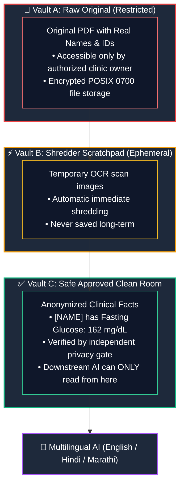

# 🏥 Clinivara: Privacy-First Clinical Document Intelligence

> **Understand Medical Reports in Simple Words — Without Ever Leaking Private Patient Data.**

Clinivara is an intelligent, privacy-first healthcare document platform. It acts like an **Ironclad Privacy Shield** and a **Friendly Multilingual Medical Assistant**: it takes complex lab reports (PDFs, doctor notes, lab scans), removes all personal identity markers (names, phone numbers, Aadhaar/IDs), and helps patients and doctors understand their reports in **English, Hindi (हिंदी), and Marathi (मराठी)**.

---

## 💡 What Problem Does Clinivara Solve?

```
+------------------------------------+       +------------------------------------+
| 🩺 The Patient's Dilemma           |       | ⚠️ The AI Privacy Trap              |
| • Lab reports use scary jargon.    |  vs.  | • Sending reports to public AI     |
| • Most patients don't speak Latin. |       |   leaks names, Aadhaar, & health.  |
| • Patients want answers in Hindi   |       | • Health data is private forever.  |
|   or Marathi.                      |       | • Once leaked, it cannot be undone.|
+------------------------------------+       +------------------------------------+
```

### 🛡️ Clinivara's Answer:
**Zero-Knowledge Medical Understanding.**  
No AI ever sees who the patient is. Only scrubbed, verified medical facts are processed.

---

## 🗺️ How It Works (The 5-Step Journey)

```mermaid
flowchart LR
    A["📄 1. Patient Uploads Report"] --> B["🔍 2. Privacy Scanner"]
    B --> C["🛡️ 3. Redact Secrets"]
    C --> D["🚦 4. Safety Gate Check"]
    D --> E["🤖 5. Friendly AI Doctor Note"]

    style A fill:#1e293b,stroke:#38bdf8,stroke-width:2px,color:#ffffff
    style B fill:#1e293b,stroke:#facc15,stroke-width:2px,color:#ffffff
    style C fill:#1e293b,stroke:#fb923c,stroke-width:2px,color:#ffffff
    style D fill:#1e293b,stroke:#4ade80,stroke-width:2px,color:#ffffff
    style E fill:#1e293b,stroke:#c084fc,stroke-width:2px,color:#ffffff
```



1. **Intake**: You upload a blood test, prescription, or scan (PDF or picture).
2. **Text & OCR Reading**: If it's a scan or photo, smart optical character recognition (OCR) reads the handwriting and printed text.
3. **De-Identification (Privacy Shield)**:
   - `John Doe` ➔ `[PATIENT_NAME]`
   - `Aadhaar: 4589 1234 5678` ➔ `[AADHAAR_ID]`
   - `Phone: 9876543210` ➔ `[PHONE_NUMBER]`
   - Clinical lab results (like `HbA1c 8.4%` or `Metformin 500 mg`) are safely kept!
4. **Independent Safety Release Gate**: A second, independent validator inspects the scrubbed text. If any personal detail leaked, **the file is locked and blocked from release**.
5. **Multilingual AI Understanding**: The safe document is explained in simple words with exact line numbers and citations.

---

## 🏰 The Three-Vault Security Architecture

Imagine a bank with 3 strictly separated, locked rooms:



- **Vault A (Raw Room)**: The original uploaded file is kept under lock and key. External users and AI systems can never peek inside.
- **Vault B (Shredder Room)**: Used for a fraction of a second to render scanned images for text recognition. Once processed, it is shredded to zero.
- **Vault C (Clean Room)**: The only room the AI and downstream systems can access. Contains pure clinical facts with all patient identities replaced with safe tags.

---

## 🌐 Multilingual Medical Explanations

Clinivara translates dense medical numbers into easy-to-understand explanations in three languages:

| Medical Report Value | Plain English | Hindi (हिंदी) | Marathi (मराठी) |
|---|---|---|---|
| `HbA1c: 8.4% (High)` | Blood sugar over the past 3 months is higher than normal. | पिछले 3 महीनों का रक्त शर्करा स्तर सामान्य से अधिक है। | मागील ३ महिन्यांची रक्तातील साखर सामान्य पातळीपेक्षा जास्त आहे. |
| `BP: 135/85 mmHg` | Blood pressure is mildly elevated. | रक्तचाप सामान्य से थोड़ा अधिक है। | रक्तदाब सामान्य पातळीपेक्षा किंचित जास्त आहे. |
| `Metformin 500 mg PO BID` | Take 1 tablet by mouth twice a day. | दिन में दो बार मुंह से 1 गोली लें। | दिवसातून दोनदा तोंडाने १ गोळी घ्या. |

---

## 🔒 What Security Improvements Were Done?

We recently conducted a complete engineering security audit and pushed hardened protections:

1. **No Default Passwords in Production**: The system refuses to boot up if insecure testing passwords or default developer keys are detected in production.
2. **Anti-Escape Door Locks (Path Traversal Protection)**: Files and tenant accounts are strictly jailed into their own folders—malicious requests cannot escape into the operating system.
3. **Upload Flood Protection**: Huge files are read in small pieces and cut off before they can eat up server memory or crash the application.
4. **Error Masking**: If something unexpected happens, patients and users get a safe error message without technical code or system paths leaking.
5. **Automated Security Guard (GitHub Actions CI)**: Every line of code pushed to GitHub is automatically tested and scanned by a security robot for secret leaks and test correctness.

---

## 🚀 Quick Start (For Developers & Clinics)

### 1. Requirements
- Python 3.12+
- Tesseract OCR (with English, Hindi, and Marathi language packs)

### 2. Setup
```bash
# Clone the repository
git clone https://github.com/AbhijeetArunGore/Clinivara.git
cd Clinivara

# Create virtual environment & install dependencies
python -m venv .venv
.\.venv\Scripts\activate
pip install -e ".[dev]"
python -m spacy download en_core_web_sm
```

### 3. Run Automated Tests (69 Tests)
```bash
pytest -v
```

### 4. Start the Application
```bash
uvicorn clinivara.main:app --reload --host 127.0.0.1 --port 8000
```
- Open Swagger API documentation: `http://127.0.0.1:8000/docs`

---

## 📚 Complete Technical Documentation

- 🔍 **[Security Audit Report](docs/security-audit.md)**: Full CVE/CWE vulnerability findings and verification proof.
- 🛠️ **[Security Remediation Action Log](docs/security-remediation.md)**: Operational guide for production deployments.
- 📐 **[System Architecture](docs/architecture.md)**: Detailed component diagrams and data trust boundaries.
- 🔒 **[Security & Threat Model](docs/security.md)**: Defense-in-depth principles and encryption rules.
- 🏷️ **[De-identification Policy](docs/deidentification-policy.md)**: Presidio & spaCy recognizer rules and whitelists.
- 📡 **[REST API Specification](docs/api.md)**: Complete request and response JSON schemas.
- 🧪 **[Testing Strategy](docs/testing.md)**: Unit, integration, adversarial, and regression testing.

---

## ⚠️ Important Healthcare Disclaimers

> **Notice**: Clinivara is an applied engineering prototype designed for privacy-preserving document understanding.  
> 1. **Not a Doctor**: Explanations generated by the AI subsystem are for educational and patient empowerment purposes and do not substitute for professional medical diagnosis or clinical advice.  
> 2. **Imperfect De-Identification**: While state-of-the-art NLP recognizers are utilized, automated de-identification reduces risk but cannot mathematically guarantee 100% anonymization across every conceivable handwriting variation.  
> 3. **Regulatory Readiness**: Formal HIPAA, GDPR, or DPDP compliance requires organizational policies, business associate agreements (BAAs), and administrative safeguards beyond technical source code.
